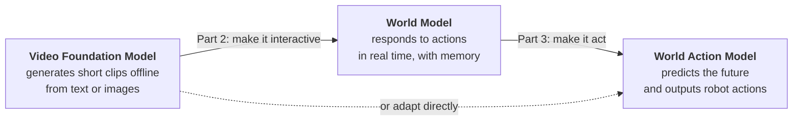

# Awesome Video-to-World-Action Models

**From Video Foundation Models to World Models and World Action Models: A Survey of Construction Recipes**

   

## Overview

Large video generators have learned a lot about how the world looks and moves, and a fast-growing line of work reuses them as the backbone of **world models**, which simulate how an environment responds to actions, and **world action models (WAMs)**, which predict the future *and* output robot actions. This list is organized around one practical question: **how is a pretrained video foundation model turned into a world model, and then into a world action model?** Each part below collects the papers that answer one step of this recipe.

### What each step adds

<table>
  <tr>
    <th width="16%"></th>
    <th width="42%">Video Foundation Model &rarr; World Model</th>
    <th width="42%">World Model &rarr; World Action Model</th>
  </tr>
  <tr>
    <td align="center"><b>Data</b></td>
    <td><ul><li>Game, driving and navigation videos</li><li>Camera-pose and action labels</li><li>Latent actions for unlabeled video</li></ul></td>
    <td><ul><li>Internet video</li><li>Egocentric human video</li><li>Robot trajectories with action labels</li></ul></td>
  </tr>
  <tr>
    <td align="center"><b>Architecture</b></td>
    <td><ul><li>Action / camera conditioning</li><li>Causal attention with KV cache</li><li>Memory for long rollouts</li></ul></td>
    <td><ul><li>Inverse dynamics or action heads</li><li>Actions as tokens in the video backbone</li><li>Separate video and action experts</li></ul></td>
  </tr>
  <tr>
    <td align="center"><b>Training</b></td>
    <td><ol><li>Action fine-tuning</li><li>Causal (autoregressive) training</li><li>Few-step distillation for real time</li></ol></td>
    <td><ol><li>Transitional pretraining</li><li>Joint video-action training</li><li>Action-only mode for deployment</li></ol></td>
  </tr>
</table>

A recurring theme across both steps: **every new capability risks erasing the priors learned during video pretraining**, and much of the recent work is about adding capabilities without forgetting the world.

## Contents

- [Related Surveys](#related-surveys)
  - [Video-to-World Roadmaps](#video-to-world-roadmaps)
  - [World Models & World Action Models for Embodied AI](#world-models--world-action-models-for-embodied-ai)
  - [Topic-Specific Surveys](#topic-specific-surveys)
- [Part 1: Video Foundation Models](#part-1-video-foundation-models)
  - [Foundation Models & Architectures](#foundation-models--architectures)
  - [World Knowledge in Video Models (Physics & Chain-of-Frames Reasoning)](#world-knowledge-in-video-models-physics--chain-of-frames-reasoning)
  - [Post-Training & Alignment](#post-training--alignment)
- [Part 2: From Video Foundation Models to World Models](#part-2-from-video-foundation-models-to-world-models)
  - [Interactive World Models (Games, Driving, Navigation)](#interactive-world-models-games-driving-navigation)
  - [Action / Camera Conditioning & Adaptation](#action--camera-conditioning--adaptation)
  - [Causalization & Real-Time Distillation](#causalization--real-time-distillation)
  - [Full-Stack Recipes](#full-stack-recipes)
  - [Memory & Long-Horizon Persistence](#memory--long-horizon-persistence)
  - [Latent World Models & Planning (Contrast to Pixel-Space Models)](#latent-world-models--planning-contrast-to-pixel-space-models)
  - [Benchmarks](#benchmarks)
- [Part 3: From World Models to World Action Models](#part-3-from-world-models-to-world-action-models)
  - [Imagine-then-Execute](#imagine-then-execute)
  - [Video Pretraining for Policies & Latent Actions](#video-pretraining-for-policies--latent-actions)
  - [Joint Video-Action Models](#joint-video-action-models)
  - [Inference Regimes & Rollout Verification](#inference-regimes--rollout-verification)
  - [World Models as Simulators, Data Engines & Evaluators](#world-models-as-simulators-data-engines--evaluators)
  - [Evaluation](#evaluation)
- [Contributing](#contributing)

## Related Surveys

> Surveys and roadmaps that this list builds on. Most of them categorize methods by capability, representation, or application; this list instead follows how models are built.

### Video-to-World Roadmaps

<table>
  <tr>
    <th width="80%" align="left">Paper</th>
    <th width="10%">Date</th>
    <th width="10%">Link</th>
  </tr>
  <tr>
    <td>Understanding World or Predicting Future? A Comprehensive Survey of World Models</td>
    <td align="center">2024.11</td>
    <td align="center"><a href="https://arxiv.org/abs/2411.14499">arXiv</a></td>
  </tr>
  <tr>
    <td>Simulating the Visual World with Artificial Intelligence: A Roadmap</td>
    <td align="center">2025.11</td>
    <td align="center"><a href="https://arxiv.org/abs/2511.08585">arXiv</a></td>
  </tr>
  <tr>
    <td>Video Generation Models as World Models: Efficient Paradigms, Architectures and Algorithms</td>
    <td align="center">2026.03</td>
    <td align="center"><a href="https://arxiv.org/abs/2603.28489">arXiv</a></td>
  </tr>
  <tr>
    <td>Towards Interactive Video World Modeling: Frontiers, Challenges, Benchmarks, and Future Trends</td>
    <td align="center">2026.05</td>
    <td align="center"><a href="https://arxiv.org/abs/2606.01164">arXiv</a></td>
  </tr>
  <tr>
    <td>Reading, Writing, Sharing, and Interacting with the World through Video</td>
    <td align="center">2026.10</td>
    <td align="center"><a href="https://arxiv.org/abs/2610.31668">arXiv</a></td>
  </tr>
</table>

### World Models & World Action Models for Embodied AI

<table>
  <tr>
    <th width="80%" align="left">Paper</th>
    <th width="10%">Date</th>
    <th width="10%">Link</th>
  </tr>
  <tr>
    <td>A Comprehensive Survey on World Models for Embodied AI</td>
    <td align="center">2025.10</td>
    <td align="center"><a href="https://arxiv.org/abs/2510.16732">arXiv</a></td>
  </tr>
  <tr>
    <td>Robotic Video World Models: A Survey of Applications, Research Challenges, Future Directions</td>
    <td align="center">2026.01</td>
    <td align="center"><a href="https://arxiv.org/abs/2601.07823">arXiv</a></td>
  </tr>
  <tr>
    <td>World Models for Robotic Manipulation: A Survey</td>
    <td align="center">2026.05</td>
    <td align="center"><a href="https://arxiv.org/abs/2606.00113">arXiv</a></td>
  </tr>
  <tr>
    <td>World Action Models: A Survey</td>
    <td align="center">2026.06</td>
    <td align="center"><a href="https://arxiv.org/abs/2606.20781">arXiv</a></td>
  </tr>
  <tr>
    <td>From World Models to World Action Models: A Concise Tutorial for Robotics</td>
    <td align="center">2026.07</td>
    <td align="center"><a href="https://arxiv.org/abs/2607.00836">arXiv</a></td>
  </tr>
  <tr>
    <td>World-Action Models for Robot Learning and Control: A Survey</td>
    <td align="center">2026.09</td>
    <td align="center"><a href="https://arxiv.org/abs/2609.16074">arXiv</a></td>
  </tr>
  <tr>
    <td>World Models for Embodied Intelligence: From Plausible to Controllable to Actionable</td>
    <td align="center">2026.09</td>
    <td align="center"><a href="https://arxiv.org/abs/2609.16697">arXiv</a></td>
  </tr>
</table>

### Topic-Specific Surveys

<table>
  <tr>
    <th width="80%" align="left">Paper</th>
    <th width="10%">Date</th>
    <th width="10%">Link</th>
  </tr>
  <tr>
    <td>Controllable Video Generation: A Survey</td>
    <td align="center">2025.07</td>
    <td align="center"><a href="https://arxiv.org/abs/2507.16869">arXiv</a></td>
  </tr>
  <tr>
    <td>Efficient Video Diffusion Models: Advancements and Challenges</td>
    <td align="center">2026.04</td>
    <td align="center"><a href="https://arxiv.org/abs/2604.15911">arXiv</a></td>
  </tr>
  <tr>
    <td>Do World Models Make Better Robots? A Survey of Evaluation Benchmarks for Predictive Embodied Intelligence</td>
    <td align="center">2026.08</td>
    <td align="center"><a href="https://arxiv.org/abs/2609.29669">arXiv</a></td>
  </tr>
  <tr>
    <td>The Past Frames the Future: Memory for Autoregressive Video Generation</td>
    <td align="center">2026.09</td>
    <td align="center"><a href="https://arxiv.org/abs/2609.28466">arXiv</a></td>
  </tr>
  <tr>
    <td>Geometry-consistent Video World Models: A Survey</td>
    <td align="center">2026.09</td>
    <td align="center"><a href="https://papers.ssrn.com/sol3/papers.cfm?abstract_id=7420018">SSRN</a></td>
  </tr>
</table>

<a href="#contents">back to top</a>

## Part 1: Video Foundation Models

> The starting point: large pretrained video generators, the world knowledge they already contain, and how they are post-trained.

### Foundation Models & Architectures

<table>
  <tr>
    <th width="80%" align="left">Paper</th>
    <th width="10%">Date</th>
    <th width="10%">Link</th>
  </tr>
  <tr>
    <td>Flow Matching for Generative Modeling</td>
    <td align="center">2022.10</td>
    <td align="center"><a href="https://arxiv.org/abs/2210.02747">arXiv</a></td>
  </tr>
  <tr>
    <td>Scalable Diffusion Models with Transformers</td>
    <td align="center">2022.12</td>
    <td align="center"><a href="https://arxiv.org/abs/2212.09748">arXiv</a></td>
  </tr>
  <tr>
    <td>CogVideoX: Text-to-Video Diffusion Models with An Expert Transformer</td>
    <td align="center">2024.08</td>
    <td align="center"><a href="https://arxiv.org/abs/2408.06072">arXiv</a></td>
  </tr>
  <tr>
    <td>Movie Gen: A Cast of Media Foundation Models</td>
    <td align="center">2024.10</td>
    <td align="center"><a href="https://arxiv.org/abs/2410.13720">arXiv</a></td>
  </tr>
  <tr>
    <td>HunyuanVideo: A Systematic Framework For Large Video Generative Models</td>
    <td align="center">2024.12</td>
    <td align="center"><a href="https://arxiv.org/abs/2412.03603">arXiv</a></td>
  </tr>
  <tr>
    <td>Open-Sora: Democratizing Efficient Video Production for All</td>
    <td align="center">2024.12</td>
    <td align="center"><a href="https://arxiv.org/abs/2412.20404">arXiv</a></td>
  </tr>
  <tr>
    <td>Video Generation Models as World Simulators</td>
    <td align="center">2024.02</td>
    <td align="center"><a href="https://openai.com/index/video-generation-models-as-world-simulators/">Report</a></td>
  </tr>
  <tr>
    <td>Cosmos World Foundation Model Platform for Physical AI</td>
    <td align="center">2025.01</td>
    <td align="center"><a href="https://arxiv.org/abs/2501.03575">arXiv</a></td>
  </tr>
  <tr>
    <td>Wan: Open and Advanced Large-Scale Video Generative Models</td>
    <td align="center">2025.03</td>
    <td align="center"><a href="https://arxiv.org/abs/2503.20314">arXiv</a></td>
  </tr>
  <tr>
    <td>MAGI-1: Autoregressive Video Generation at Scale</td>
    <td align="center">2025.05</td>
    <td align="center"><a href="https://arxiv.org/abs/2505.13211">arXiv</a></td>
  </tr>
</table>

### World Knowledge in Video Models (Physics & Chain-of-Frames Reasoning)

<table>
  <tr>
    <th width="80%" align="left">Paper</th>
    <th width="10%">Date</th>
    <th width="10%">Link</th>
  </tr>
  <tr>
    <td>How Far is Video Generation from World Model: A Physical Law Perspective</td>
    <td align="center">2024.11</td>
    <td align="center"><a href="https://arxiv.org/abs/2411.02385">arXiv</a></td>
  </tr>
  <tr>
    <td>Do generative video models understand physical principles?</td>
    <td align="center">2025.01</td>
    <td align="center"><a href="https://arxiv.org/abs/2501.09038">arXiv</a></td>
  </tr>
  <tr>
    <td>V-JEPA 2: Self-Supervised Video Models Enable Understanding, Prediction and Planning</td>
    <td align="center">2025.06</td>
    <td align="center"><a href="https://arxiv.org/abs/2506.09985">arXiv</a></td>
  </tr>
  <tr>
    <td>Video models are zero-shot learners and reasoners</td>
    <td align="center">2025.09</td>
    <td align="center"><a href="https://arxiv.org/abs/2509.20328">arXiv</a></td>
  </tr>
  <tr>
    <td>Are Video Models Ready as Zero-Shot Reasoners? An Empirical Study with the MME-CoF Benchmark</td>
    <td align="center">2025.10</td>
    <td align="center"><a href="https://arxiv.org/abs/2510.26802">arXiv</a></td>
  </tr>
</table>

### Post-Training & Alignment

<table>
  <tr>
    <th width="80%" align="left">Paper</th>
    <th width="10%">Date</th>
    <th width="10%">Link</th>
  </tr>
  <tr>
    <td>Improving Video Generation with Human Feedback</td>
    <td align="center">2025.01</td>
    <td align="center"><a href="https://arxiv.org/abs/2501.13918">arXiv</a></td>
  </tr>
  <tr>
    <td>DanceGRPO: Unleashing GRPO on Visual Generation</td>
    <td align="center">2025.05</td>
    <td align="center"><a href="https://arxiv.org/abs/2505.07818">arXiv</a></td>
  </tr>
</table>

<a href="#contents">back to top</a>

## Part 2: From Video Foundation Models to World Models

> Turning an offline, bidirectional video generator into an interactive simulator: add action or camera control, make generation causal, distill it for real-time rollout, and give it memory.

### Interactive World Models (Games, Driving, Navigation)

<table>
  <tr>
    <th width="80%" align="left">Paper</th>
    <th width="10%">Date</th>
    <th width="10%">Link</th>
  </tr>
  <tr>
    <td>GAIA-1: A Generative World Model for Autonomous Driving</td>
    <td align="center">2023.09</td>
    <td align="center"><a href="https://arxiv.org/abs/2309.17080">arXiv</a></td>
  </tr>
  <tr>
    <td>Learning Interactive Real-World Simulators</td>
    <td align="center">2023.10</td>
    <td align="center"><a href="https://arxiv.org/abs/2310.06114">arXiv</a></td>
  </tr>
  <tr>
    <td>Genie: Generative Interactive Environments</td>
    <td align="center">2024.02</td>
    <td align="center"><a href="https://arxiv.org/abs/2402.15391">arXiv</a></td>
  </tr>
  <tr>
    <td>Vista: A Generalizable Driving World Model with High Fidelity and Versatile Controllability</td>
    <td align="center">2024.05</td>
    <td align="center"><a href="https://arxiv.org/abs/2405.17398">arXiv</a></td>
  </tr>
  <tr>
    <td>Diffusion Models Are Real-Time Game Engines</td>
    <td align="center">2024.08</td>
    <td align="center"><a href="https://arxiv.org/abs/2408.14837">arXiv</a></td>
  </tr>
  <tr>
    <td>GameFactory: Creating New Games with Generative Interactive Videos</td>
    <td align="center">2025.01</td>
    <td align="center"><a href="https://arxiv.org/abs/2501.08325">arXiv</a></td>
  </tr>
  <tr>
    <td>Matrix-Game 2.0: An Open-Source, Real-Time, and Streaming Interactive World Model</td>
    <td align="center">2025.08</td>
    <td align="center"><a href="https://arxiv.org/abs/2508.13009">arXiv</a></td>
  </tr>
  <tr>
    <td>WorldPlay: Towards Long-Term Geometric Consistency for Real-Time Interactive World Modeling</td>
    <td align="center">2025.12</td>
    <td align="center"><a href="https://arxiv.org/abs/2512.14614">arXiv</a></td>
  </tr>
  <tr>
    <td>Genie 3: A New Frontier for World Models</td>
    <td align="center">2025.08</td>
    <td align="center"><a href="https://deepmind.google/discover/blog/genie-3-a-new-frontier-for-world-models/">Blog</a></td>
  </tr>
</table>

### Action / Camera Conditioning & Adaptation

<table>
  <tr>
    <th width="80%" align="left">Paper</th>
    <th width="10%">Date</th>
    <th width="10%">Link</th>
  </tr>
  <tr>
    <td>CameraCtrl: Enabling Camera Control for Text-to-Video Generation</td>
    <td align="center">2024.04</td>
    <td align="center"><a href="https://arxiv.org/abs/2404.02101">arXiv</a></td>
  </tr>
  <tr>
    <td>AVID: Adapting Video Diffusion Models to World Models</td>
    <td align="center">2024.10</td>
    <td align="center"><a href="https://arxiv.org/abs/2410.12822">arXiv</a></td>
  </tr>
</table>

### Causalization & Real-Time Distillation

<table>
  <tr>
    <th width="80%" align="left">Paper</th>
    <th width="10%">Date</th>
    <th width="10%">Link</th>
  </tr>
  <tr>
    <td>Diffusion Forcing: Next-token Prediction Meets Full-Sequence Diffusion</td>
    <td align="center">2024.07</td>
    <td align="center"><a href="https://arxiv.org/abs/2407.01392">arXiv</a></td>
  </tr>
  <tr>
    <td>From Slow Bidirectional to Fast Autoregressive Video Diffusion Models</td>
    <td align="center">2024.12</td>
    <td align="center"><a href="https://arxiv.org/abs/2412.07772">arXiv</a></td>
  </tr>
  <tr>
    <td>Self Forcing: Bridging the Train-Test Gap in Autoregressive Video Diffusion</td>
    <td align="center">2025.06</td>
    <td align="center"><a href="https://arxiv.org/abs/2506.08009">arXiv</a></td>
  </tr>
  <tr>
    <td>Rolling Forcing: Autoregressive Long Video Diffusion in Real Time</td>
    <td align="center">2025.09</td>
    <td align="center"><a href="https://arxiv.org/abs/2509.25161">arXiv</a></td>
  </tr>
  <tr>
    <td>Self-Forcing++: Towards Minute-Scale High-Quality Video Generation</td>
    <td align="center">2025.10</td>
    <td align="center"><a href="https://arxiv.org/abs/2510.02283">arXiv</a></td>
  </tr>
  <tr>
    <td>Causal Forcing: Autoregressive Diffusion Distillation Done Right for High-Quality Real-Time Interactive Video Generation</td>
    <td align="center">2026.02</td>
    <td align="center"><a href="https://arxiv.org/abs/2602.02214">arXiv</a></td>
  </tr>
  <tr>
    <td>Causal-rCM: A Unified Teacher-Forcing and Self-Forcing Open Recipe for Autoregressive Diffusion Distillation in Streaming Video Generation and Interactive World Models</td>
    <td align="center">2026.06</td>
    <td align="center"><a href="https://arxiv.org/abs/2606.25473">arXiv</a></td>
  </tr>
  <tr>
    <td>Looking Ahead: Modeling Future Evolution in Autoregressive Video Generation</td>
    <td align="center">2026.10</td>
    <td align="center"><a href="https://arxiv.org/abs/2610.29989">arXiv</a></td>
  </tr>
</table>

### Full-Stack Recipes

<table>
  <tr>
    <th width="80%" align="left">Paper</th>
    <th width="10%">Date</th>
    <th width="10%">Link</th>
  </tr>
  <tr>
    <td>Matrix-Game 3.0: Real-Time and Streaming Interactive World Model with Long-Horizon Memory</td>
    <td align="center">2026.04</td>
    <td align="center"><a href="https://arxiv.org/abs/2604.08995">arXiv</a></td>
  </tr>
  <tr>
    <td>minWM: A Full-Stack Open-Source Framework for Real-Time Interactive Video World Models</td>
    <td align="center">2026.05</td>
    <td align="center"><a href="https://arxiv.org/abs/2605.30263">arXiv</a></td>
  </tr>
  <tr>
    <td>ForgeWM: Progressive Causal Training for Few-Step Action-Conditioned Video World Models</td>
    <td align="center">2026.08</td>
    <td align="center"><a href="https://arxiv.org/abs/2608.14022">arXiv</a></td>
  </tr>
  <tr>
    <td>Mix Forcing: Causal Pre-Training via Mixture Attention for Interactive World Models</td>
    <td align="center">2026.10</td>
    <td align="center"><a href="https://arxiv.org/abs/2610.33589">arXiv</a></td>
  </tr>
</table>

### Memory & Long-Horizon Persistence

<table>
  <tr>
    <th width="80%" align="left">Paper</th>
    <th width="10%">Date</th>
    <th width="10%">Link</th>
  </tr>
  <tr>
    <td>WorldMem: Long-term Consistent World Simulation with Memory</td>
    <td align="center">2025.04</td>
    <td align="center"><a href="https://arxiv.org/abs/2504.12369">arXiv</a></td>
  </tr>
  <tr>
    <td>Context as Memory: Scene-Consistent Interactive Long Video Generation with Memory Retrieval</td>
    <td align="center">2025.06</td>
    <td align="center"><a href="https://arxiv.org/abs/2506.03141">arXiv</a></td>
  </tr>
  <tr>
    <td>VMem: Consistent Interactive Video Scene Generation with Surfel-Indexed View Memory</td>
    <td align="center">2025.06</td>
    <td align="center"><a href="https://arxiv.org/abs/2506.18903">arXiv</a></td>
  </tr>
  <tr>
    <td>Geometry-Aware Implicit Memory for Video World Models</td>
    <td align="center">2026.06</td>
    <td align="center"><a href="https://arxiv.org/abs/2606.02436">arXiv</a></td>
  </tr>
  <tr>
    <td>Spatial Memory Intelligence: Endowing World Models with Understanding-Driven Long-Term Memory</td>
    <td align="center">2026.10</td>
    <td align="center"><a href="https://arxiv.org/abs/2610.02521">arXiv</a></td>
  </tr>
  <tr>
    <td>More Memory, Better Videos? A Controlled Study of Visual Memory in Long-Video Generation</td>
    <td align="center">2026.10</td>
    <td align="center"><a href="https://arxiv.org/abs/2610.35001">arXiv</a></td>
  </tr>
</table>

### Latent World Models & Planning (Contrast to Pixel-Space Models)

<table>
  <tr>
    <th width="80%" align="left">Paper</th>
    <th width="10%">Date</th>
    <th width="10%">Link</th>
  </tr>
  <tr>
    <td>DINO-WM: World Models on Pre-trained Visual Features enable Zero-shot Planning</td>
    <td align="center">2024.11</td>
    <td align="center"><a href="https://arxiv.org/abs/2411.04983">arXiv</a></td>
  </tr>
  <tr>
    <td>Navigation World Models</td>
    <td align="center">2024.12</td>
    <td align="center"><a href="https://arxiv.org/abs/2412.03572">arXiv</a></td>
  </tr>
  <tr>
    <td>What Drives Success in Physical Planning with Joint-Embedding Predictive World Models?</td>
    <td align="center">2025.12</td>
    <td align="center"><a href="https://arxiv.org/abs/2512.24497">arXiv</a></td>
  </tr>
  <tr>
    <td>AD-E2E-JEPA: A Joint-Embedding Predictive Architecture For End-to-End Autonomous Driving</td>
    <td align="center">2026.09</td>
    <td align="center"><a href="https://arxiv.org/abs/2609.34085">arXiv</a></td>
  </tr>
</table>

### Benchmarks

<table>
  <tr>
    <th width="80%" align="left">Paper</th>
    <th width="10%">Date</th>
    <th width="10%">Link</th>
  </tr>
  <tr>
    <td>WBench: A Comprehensive Multi-turn Benchmark for Interactive Video World Model Evaluation</td>
    <td align="center">2026.05</td>
    <td align="center"><a href="https://arxiv.org/abs/2605.25874">arXiv</a></td>
  </tr>
  <tr>
    <td>WorldMemBench: A Comprehensive Benchmark for Memory of Video World Models</td>
    <td align="center">2026.10</td>
    <td align="center"><a href="https://arxiv.org/abs/2610.19063">arXiv</a></td>
  </tr>
</table>

<a href="#contents">back to top</a>

## Part 3: From World Models to World Action Models

> Teaching a video or world model to act: choose the data ladder, decide where actions enter the network, pick an action representation, and stage the training.

### Imagine-then-Execute

<table>
  <tr>
    <th width="80%" align="left">Paper</th>
    <th width="10%">Date</th>
    <th width="10%">Link</th>
  </tr>
  <tr>
    <td>Learning Universal Policies via Text-Guided Video Generation</td>
    <td align="center">2023.01</td>
    <td align="center"><a href="https://arxiv.org/abs/2302.00111">arXiv</a></td>
  </tr>
  <tr>
    <td>Learning to Act from Actionless Videos through Dense Correspondences</td>
    <td align="center">2023.10</td>
    <td align="center"><a href="https://arxiv.org/abs/2310.08576">arXiv</a></td>
  </tr>
  <tr>
    <td>Video Language Planning</td>
    <td align="center">2023.10</td>
    <td align="center"><a href="https://arxiv.org/abs/2310.10625">arXiv</a></td>
  </tr>
  <tr>
    <td>Gen2Act: Human Video Generation in Novel Scenarios enables Generalizable Robot Manipulation</td>
    <td align="center">2024.09</td>
    <td align="center"><a href="https://arxiv.org/abs/2409.16283">arXiv</a></td>
  </tr>
  <tr>
    <td>Vidar: Embodied Video Diffusion Model for Generalist Manipulation</td>
    <td align="center">2025.07</td>
    <td align="center"><a href="https://arxiv.org/abs/2507.12898">arXiv</a></td>
  </tr>
  <tr>
    <td>NovaFlow: Zero-Shot Manipulation via Actionable Flow from Generated Videos</td>
    <td align="center">2025.10</td>
    <td align="center"><a href="https://arxiv.org/abs/2510.08568">arXiv</a></td>
  </tr>
  <tr>
    <td>Dream2Flow: Bridging Video Generation and Open-World Manipulation with 3D Object Flow</td>
    <td align="center">2025.12</td>
    <td align="center"><a href="https://arxiv.org/abs/2512.24766">arXiv</a></td>
  </tr>
</table>

### Video Pretraining for Policies & Latent Actions

<table>
  <tr>
    <th width="80%" align="left">Paper</th>
    <th width="10%">Date</th>
    <th width="10%">Link</th>
  </tr>
  <tr>
    <td>Unleashing Large-Scale Video Generative Pre-training for Visual Robot Manipulation</td>
    <td align="center">2023.12</td>
    <td align="center"><a href="https://arxiv.org/abs/2312.13139">arXiv</a></td>
  </tr>
  <tr>
    <td>GR-2: A Generative Video-Language-Action Model with Web-Scale Knowledge for Robot Manipulation</td>
    <td align="center">2024.10</td>
    <td align="center"><a href="https://arxiv.org/abs/2410.06158">arXiv</a></td>
  </tr>
  <tr>
    <td>Latent Action Pretraining from Videos</td>
    <td align="center">2024.10</td>
    <td align="center"><a href="https://arxiv.org/abs/2410.11758">arXiv</a></td>
  </tr>
  <tr>
    <td>Video Prediction Policy: A Generalist Robot Policy with Predictive Visual Representations</td>
    <td align="center">2024.12</td>
    <td align="center"><a href="https://arxiv.org/abs/2412.14803">arXiv</a></td>
  </tr>
  <tr>
    <td>Predictive Inverse Dynamics Models are Scalable Learners for Robotic Manipulation</td>
    <td align="center">2024.12</td>
    <td align="center"><a href="https://arxiv.org/abs/2412.15109">arXiv</a></td>
  </tr>
</table>

### Joint Video-Action Models

<table>
  <tr>
    <th width="80%" align="left">Paper</th>
    <th width="10%">Date</th>
    <th width="10%">Link</th>
  </tr>
  <tr>
    <td>Prediction with Action: Visual Policy Learning via Joint Denoising Process</td>
    <td align="center">2024.11</td>
    <td align="center"><a href="https://arxiv.org/abs/2411.18179">arXiv</a></td>
  </tr>
  <tr>
    <td>Unified Video Action Model</td>
    <td align="center">2025.02</td>
    <td align="center"><a href="https://arxiv.org/abs/2503.00200">arXiv</a></td>
  </tr>
  <tr>
    <td>Unified World Models: Coupling Video and Action Diffusion for Pretraining on Large Robotic Datasets</td>
    <td align="center">2025.04</td>
    <td align="center"><a href="https://arxiv.org/abs/2504.02792">arXiv</a></td>
  </tr>
  <tr>
    <td>WorldVLA: Towards Autoregressive Action World Model</td>
    <td align="center">2025.06</td>
    <td align="center"><a href="https://arxiv.org/abs/2506.21539">arXiv</a></td>
  </tr>
  <tr>
    <td>Genie Envisioner: A Unified World Foundation Platform for Robotic Manipulation</td>
    <td align="center">2025.08</td>
    <td align="center"><a href="https://arxiv.org/abs/2508.05635">arXiv</a></td>
  </tr>
  <tr>
    <td>Motus: A Unified Latent Action World Model</td>
    <td align="center">2025.12</td>
    <td align="center"><a href="https://arxiv.org/abs/2512.13030">arXiv</a></td>
  </tr>
  <tr>
    <td>Cosmos Policy: Fine-Tuning Video Models for Visuomotor Control and Planning</td>
    <td align="center">2026.01</td>
    <td align="center"><a href="https://arxiv.org/abs/2601.16163">arXiv</a></td>
  </tr>
  <tr>
    <td>Causal World Modeling for Robot Control</td>
    <td align="center">2026.01</td>
    <td align="center"><a href="https://arxiv.org/abs/2601.21998">arXiv</a></td>
  </tr>
  <tr>
    <td>World Action Models are Zero-shot Policies</td>
    <td align="center">2026.02</td>
    <td align="center"><a href="https://arxiv.org/abs/2602.15922">arXiv</a></td>
  </tr>
  <tr>
    <td>TAPESTRY: A Single Backbone for Video Generation and Robot Control</td>
    <td align="center">2026.10</td>
    <td align="center"><a href="https://arxiv.org/abs/2610.36823">arXiv</a></td>
  </tr>
  <tr>
    <td>SWAM: Scaling World Action Models with Cross-Modal Alignment</td>
    <td align="center">2026.11</td>
    <td align="center"><a href="https://arxiv.org/abs/2611.12870">arXiv</a></td>
  </tr>
</table>

### Inference Regimes & Rollout Verification

<table>
  <tr>
    <th width="80%" align="left">Paper</th>
    <th width="10%">Date</th>
    <th width="10%">Link</th>
  </tr>
  <tr>
    <td>Fast-WAM: Do World Action Models Need Test-time Future Imagination?</td>
    <td align="center">2026.03</td>
    <td align="center"><a href="https://arxiv.org/abs/2603.16666">arXiv</a></td>
  </tr>
  <tr>
    <td>World Action Verifier: Self-Improving World Models via Forward-Inverse Asymmetry</td>
    <td align="center">2026.04</td>
    <td align="center"><a href="https://arxiv.org/abs/2604.01985">arXiv</a></td>
  </tr>
  <tr>
    <td>Seeing Through the Illusion: Test-Time Scaling for World Action Models</td>
    <td align="center">2026.11</td>
    <td align="center"><a href="https://arxiv.org/abs/2611.03585">arXiv</a></td>
  </tr>
</table>

### World Models as Simulators, Data Engines & Evaluators

<table>
  <tr>
    <th width="80%" align="left">Paper</th>
    <th width="10%">Date</th>
    <th width="10%">Link</th>
  </tr>
  <tr>
    <td>IRASim: A Fine-Grained World Model for Robot Manipulation</td>
    <td align="center">2024.06</td>
    <td align="center"><a href="https://arxiv.org/abs/2406.14540">arXiv</a></td>
  </tr>
  <tr>
    <td>DreamGen: Unlocking Generalization in Robot Learning through Video World Models</td>
    <td align="center">2025.05</td>
    <td align="center"><a href="https://arxiv.org/abs/2505.12705">arXiv</a></td>
  </tr>
  <tr>
    <td>WorldEval: World Model as Real-World Robot Policies Evaluator</td>
    <td align="center">2025.05</td>
    <td align="center"><a href="https://arxiv.org/abs/2505.19017">arXiv</a></td>
  </tr>
  <tr>
    <td>Ctrl-World: A Controllable Generative World Model for Robot Manipulation</td>
    <td align="center">2025.10</td>
    <td align="center"><a href="https://arxiv.org/abs/2510.10125">arXiv</a></td>
  </tr>
</table>

### Evaluation

<table>
  <tr>
    <th width="80%" align="left">Paper</th>
    <th width="10%">Date</th>
    <th width="10%">Link</th>
  </tr>
  <tr>
    <td>WFM-Eval: An Evaluation Framework for Video World Models in Robotic Manipulation</td>
    <td align="center">2026</td>
    <td align="center"><a href="https://sahilkhose.github.io/wfm-eval-cvpr26/">Project</a></td>
  </tr>
  <tr>
    <td>Do World Models Make Better Robots? A Survey of Evaluation Benchmarks for Predictive Embodied Intelligence</td>
    <td align="center">2026.08</td>
    <td align="center"><a href="https://arxiv.org/abs/2609.29669">arXiv</a></td>
  </tr>
</table>

<a href="#contents">back to top</a>

## Contributing

This list is actively maintained. If you find a missing paper or a wrong link, feel free to open an issue or submit a pull request.
