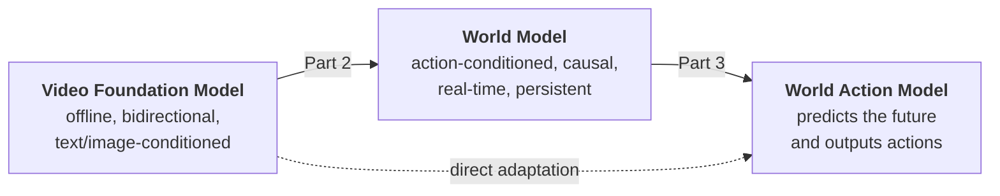

# Awesome Video-to-World-Action Models

**From Video Foundation Models to World Models and World Action Models: A Survey of Construction Recipes**

   

## Overview

Large video generators have learned a lot about how the world looks and moves. A fast-growing line of work reuses them as the backbone of **world models** (simulate how an environment responds to actions) and **world action models (WAMs)** (predict the future *and* output robot actions).

This list is organized around one practical question: **how is a pretrained video foundation model turned into a world model, and then into a world action model?** Each part collects the papers that answer one step of this recipe.

### What each step adds

| Step | Data | Architecture | Training |
|---|---|---|---|
| **Video Foundation Model → World Model** | Game, driving, navigation and camera-labeled videos | Action / camera conditioning, causal attention, KV cache, memory | Action fine-tuning → causal training → few-step distillation |
| **World Model → World Action Model** | Internet video → egocentric human video → robot trajectories | Inverse dynamics, action heads, action tokens, video-action experts | Transitional pretraining → joint video-action training → action-only deployment |

A recurring theme across both steps: **every new capability risks erasing the priors learned during video pretraining**, and much of the recent work is about adding capabilities without forgetting the world.

## Contents

- [Related Surveys](#related-surveys)
  - [Video-to-World Roadmaps](#video-to-world-roadmaps)
  - [World Models & World Action Models for Embodied AI](#world-models--world-action-models-for-embodied-ai)
  - [Topic-Specific Surveys](#topic-specific-surveys)
- [Part 1: Video Foundation Models](#part-1-video-foundation-models)
  - [Foundation Models & Architectures](#foundation-models--architectures)
  - [World Knowledge in Video Models (Physics & Chain-of-Frames Reasoning)](#world-knowledge-in-video-models-physics--chain-of-frames-reasoning)
  - [Post-Training & Alignment](#post-training--alignment)
- [Part 2: From Video Foundation Models to World Models](#part-2-from-video-foundation-models-to-world-models)
  - [Interactive World Models (Games, Driving, Navigation)](#interactive-world-models-games-driving-navigation)
  - [Action / Camera Conditioning & Adaptation](#action--camera-conditioning--adaptation)
  - [Causalization & Real-Time Distillation](#causalization--real-time-distillation)
  - [Full-Stack Recipes](#full-stack-recipes)
  - [Memory & Long-Horizon Persistence](#memory--long-horizon-persistence)
  - [Latent World Models & Planning (Contrast to Pixel-Space Models)](#latent-world-models--planning-contrast-to-pixel-space-models)
  - [Benchmarks](#benchmarks)
- [Part 3: From World Models to World Action Models](#part-3-from-world-models-to-world-action-models)
  - [Imagine-then-Execute](#imagine-then-execute)
  - [Video Pretraining for Policies & Latent Actions](#video-pretraining-for-policies--latent-actions)
  - [Joint Video-Action Models](#joint-video-action-models)
  - [Inference Regimes & Rollout Verification](#inference-regimes--rollout-verification)
  - [World Models as Simulators, Data Engines & Evaluators](#world-models-as-simulators-data-engines--evaluators)
  - [Evaluation](#evaluation)
- [Contributing](#contributing)

## Related Surveys

> Surveys and roadmaps that this list builds on. Most of them categorize methods by capability, representation, or application; this list instead follows how models are built.

### Video-to-World Roadmaps

| Title | Date | Link |
|:---|:---:|:---:|
| Understanding World or Predicting Future? A Comprehensive Survey of World Models | arXiv 2024.11 | [arXiv](https://arxiv.org/abs/2411.14499) |
| Simulating the Visual World with Artificial Intelligence: A Roadmap | arXiv 2025.11 | [arXiv](https://arxiv.org/abs/2511.08585) |
| Video Generation Models as World Models: Efficient Paradigms, Architectures and Algorithms | arXiv 2026.03 | [arXiv](https://arxiv.org/abs/2603.28489) |
| Towards Interactive Video World Modeling: Frontiers, Challenges, Benchmarks, and Future Trends | arXiv 2026.05 | [arXiv](https://arxiv.org/abs/2606.01164) |
| Reading, Writing, Sharing, and Interacting with the World through Video | arXiv 2026.10 | [arXiv](https://arxiv.org/abs/2610.31668) |

### World Models & World Action Models for Embodied AI

| Title | Date | Link |
|:---|:---:|:---:|
| A Comprehensive Survey on World Models for Embodied AI | arXiv 2025.10 | [arXiv](https://arxiv.org/abs/2510.16732) |
| Robotic Video World Models: A Survey of Applications, Research Challenges, Future Directions | arXiv 2026.01 | [arXiv](https://arxiv.org/abs/2601.07823) |
| World Models for Robotic Manipulation: A Survey | arXiv 2026.05 | [arXiv](https://arxiv.org/abs/2606.00113) |
| World Action Models: A Survey | arXiv 2026.06 | [arXiv](https://arxiv.org/abs/2606.20781) |
| From World Models to World Action Models: A Concise Tutorial for Robotics | arXiv 2026.07 | [arXiv](https://arxiv.org/abs/2607.00836) |
| World-Action Models for Robot Learning and Control: A Survey | arXiv 2026.09 | [arXiv](https://arxiv.org/abs/2609.16074) |
| World Models for Embodied Intelligence: From Plausible to Controllable to Actionable | arXiv 2026.09 | [arXiv](https://arxiv.org/abs/2609.16697) |

### Topic-Specific Surveys

| Title | Date | Link |
|:---|:---:|:---:|
| Controllable Video Generation: A Survey | arXiv 2025.07 | [arXiv](https://arxiv.org/abs/2507.16869) |
| Efficient Video Diffusion Models: Advancements and Challenges | arXiv 2026.04 | [arXiv](https://arxiv.org/abs/2604.15911) |
| Do World Models Make Better Robots? A Survey of Evaluation Benchmarks for Predictive Embodied Intelligence | arXiv 2026.08 | [arXiv](https://arxiv.org/abs/2609.29669) |
| The Past Frames the Future: Memory for Autoregressive Video Generation | arXiv 2026.09 | [arXiv](https://arxiv.org/abs/2609.28466) |
| Geometry-consistent Video World Models: A Survey | 2026.09 | [SSRN](https://papers.ssrn.com/sol3/papers.cfm?abstract_id=7420018) |

<a href="#contents">back to top</a>

## Part 1: Video Foundation Models

> The starting point: large pretrained video generators, the world knowledge they already contain, and how they are post-trained.

### Foundation Models & Architectures

| Title | Date | Link |
|:---|:---:|:---:|
| Flow Matching for Generative Modeling | arXiv 2022.10 | [arXiv](https://arxiv.org/abs/2210.02747) |
| Scalable Diffusion Models with Transformers | arXiv 2022.12 | [arXiv](https://arxiv.org/abs/2212.09748) |
| CogVideoX: Text-to-Video Diffusion Models with An Expert Transformer | arXiv 2024.08 | [arXiv](https://arxiv.org/abs/2408.06072) |
| Movie Gen: A Cast of Media Foundation Models | arXiv 2024.10 | [arXiv](https://arxiv.org/abs/2410.13720) |
| HunyuanVideo: A Systematic Framework For Large Video Generative Models | arXiv 2024.12 | [arXiv](https://arxiv.org/abs/2412.03603) |
| Open-Sora: Democratizing Efficient Video Production for All | arXiv 2024.12 | [arXiv](https://arxiv.org/abs/2412.20404) |
| Video Generation Models as World Simulators | 2024.02 | [Report](https://openai.com/index/video-generation-models-as-world-simulators/) |
| Cosmos World Foundation Model Platform for Physical AI | arXiv 2025.01 | [arXiv](https://arxiv.org/abs/2501.03575) |
| Wan: Open and Advanced Large-Scale Video Generative Models | arXiv 2025.03 | [arXiv](https://arxiv.org/abs/2503.20314) |
| MAGI-1: Autoregressive Video Generation at Scale | arXiv 2025.05 | [arXiv](https://arxiv.org/abs/2505.13211) |

### World Knowledge in Video Models (Physics & Chain-of-Frames Reasoning)

| Title | Date | Link |
|:---|:---:|:---:|
| How Far is Video Generation from World Model: A Physical Law Perspective | arXiv 2024.11 | [arXiv](https://arxiv.org/abs/2411.02385) |
| Do generative video models understand physical principles? | arXiv 2025.01 | [arXiv](https://arxiv.org/abs/2501.09038) |
| V-JEPA 2: Self-Supervised Video Models Enable Understanding, Prediction and Planning | arXiv 2025.06 | [arXiv](https://arxiv.org/abs/2506.09985) |
| Video models are zero-shot learners and reasoners | arXiv 2025.09 | [arXiv](https://arxiv.org/abs/2509.20328) |
| Are Video Models Ready as Zero-Shot Reasoners? An Empirical Study with the MME-CoF Benchmark | arXiv 2025.10 | [arXiv](https://arxiv.org/abs/2510.26802) |

### Post-Training & Alignment

| Title | Date | Link |
|:---|:---:|:---:|
| Improving Video Generation with Human Feedback | arXiv 2025.01 | [arXiv](https://arxiv.org/abs/2501.13918) |
| DanceGRPO: Unleashing GRPO on Visual Generation | arXiv 2025.05 | [arXiv](https://arxiv.org/abs/2505.07818) |

<a href="#contents">back to top</a>

## Part 2: From Video Foundation Models to World Models

> Turning an offline, bidirectional video generator into an interactive simulator: add action or camera control, make generation causal, distill it for real-time rollout, and give it memory.

### Interactive World Models (Games, Driving, Navigation)

| Title | Date | Link |
|:---|:---:|:---:|
| GAIA-1: A Generative World Model for Autonomous Driving | arXiv 2023.09 | [arXiv](https://arxiv.org/abs/2309.17080) |
| Learning Interactive Real-World Simulators | arXiv 2023.10 | [arXiv](https://arxiv.org/abs/2310.06114) |
| Genie: Generative Interactive Environments | arXiv 2024.02 | [arXiv](https://arxiv.org/abs/2402.15391) |
| Vista: A Generalizable Driving World Model with High Fidelity and Versatile Controllability | arXiv 2024.05 | [arXiv](https://arxiv.org/abs/2405.17398) |
| Diffusion Models Are Real-Time Game Engines | arXiv 2024.08 | [arXiv](https://arxiv.org/abs/2408.14837) |
| GameFactory: Creating New Games with Generative Interactive Videos | arXiv 2025.01 | [arXiv](https://arxiv.org/abs/2501.08325) |
| Matrix-Game 2.0: An Open-Source, Real-Time, and Streaming Interactive World Model | arXiv 2025.08 | [arXiv](https://arxiv.org/abs/2508.13009) |
| WorldPlay: Towards Long-Term Geometric Consistency for Real-Time Interactive World Modeling | arXiv 2025.12 | [arXiv](https://arxiv.org/abs/2512.14614) |
| Genie 3: A New Frontier for World Models | 2025.08 | [Blog](https://deepmind.google/discover/blog/genie-3-a-new-frontier-for-world-models/) |

### Action / Camera Conditioning & Adaptation

| Title | Date | Link |
|:---|:---:|:---:|
| CameraCtrl: Enabling Camera Control for Text-to-Video Generation | arXiv 2024.04 | [arXiv](https://arxiv.org/abs/2404.02101) |
| AVID: Adapting Video Diffusion Models to World Models | arXiv 2024.10 | [arXiv](https://arxiv.org/abs/2410.12822) |

### Causalization & Real-Time Distillation

| Title | Date | Link |
|:---|:---:|:---:|
| Diffusion Forcing: Next-token Prediction Meets Full-Sequence Diffusion | arXiv 2024.07 | [arXiv](https://arxiv.org/abs/2407.01392) |
| From Slow Bidirectional to Fast Autoregressive Video Diffusion Models | arXiv 2024.12 | [arXiv](https://arxiv.org/abs/2412.07772) |
| Self Forcing: Bridging the Train-Test Gap in Autoregressive Video Diffusion | arXiv 2025.06 | [arXiv](https://arxiv.org/abs/2506.08009) |
| Rolling Forcing: Autoregressive Long Video Diffusion in Real Time | arXiv 2025.09 | [arXiv](https://arxiv.org/abs/2509.25161) |
| Self-Forcing++: Towards Minute-Scale High-Quality Video Generation | arXiv 2025.10 | [arXiv](https://arxiv.org/abs/2510.02283) |
| Causal Forcing: Autoregressive Diffusion Distillation Done Right for High-Quality Real-Time Interactive Video Generation | arXiv 2026.02 | [arXiv](https://arxiv.org/abs/2602.02214) |
| Causal-rCM: A Unified Teacher-Forcing and Self-Forcing Open Recipe for Autoregressive Diffusion Distillation in Streaming Video Generation and Interactive World Models | arXiv 2026.06 | [arXiv](https://arxiv.org/abs/2606.25473) |
| Looking Ahead: Modeling Future Evolution in Autoregressive Video Generation | arXiv 2026.10 | [arXiv](https://arxiv.org/abs/2610.29989) |

### Full-Stack Recipes

| Title | Date | Link |
|:---|:---:|:---:|
| Matrix-Game 3.0: Real-Time and Streaming Interactive World Model with Long-Horizon Memory | arXiv 2026.04 | [arXiv](https://arxiv.org/abs/2604.08995) |
| minWM: A Full-Stack Open-Source Framework for Real-Time Interactive Video World Models | arXiv 2026.05 | [arXiv](https://arxiv.org/abs/2605.30263) |
| ForgeWM: Progressive Causal Training for Few-Step Action-Conditioned Video World Models | arXiv 2026.08 | [arXiv](https://arxiv.org/abs/2608.14022) |
| Mix Forcing: Causal Pre-Training via Mixture Attention for Interactive World Models | arXiv 2026.10 | [arXiv](https://arxiv.org/abs/2610.33589) |

### Memory & Long-Horizon Persistence

| Title | Date | Link |
|:---|:---:|:---:|
| WorldMem: Long-term Consistent World Simulation with Memory | arXiv 2025.04 | [arXiv](https://arxiv.org/abs/2504.12369) |
| Context as Memory: Scene-Consistent Interactive Long Video Generation with Memory Retrieval | arXiv 2025.06 | [arXiv](https://arxiv.org/abs/2506.03141) |
| VMem: Consistent Interactive Video Scene Generation with Surfel-Indexed View Memory | arXiv 2025.06 | [arXiv](https://arxiv.org/abs/2506.18903) |
| Geometry-Aware Implicit Memory for Video World Models | arXiv 2026.06 | [arXiv](https://arxiv.org/abs/2606.02436) |
| Spatial Memory Intelligence: Endowing World Models with Understanding-Driven Long-Term Memory | arXiv 2026.10 | [arXiv](https://arxiv.org/abs/2610.02521) |
| More Memory, Better Videos? A Controlled Study of Visual Memory in Long-Video Generation | arXiv 2026.10 | [arXiv](https://arxiv.org/abs/2610.35001) |

### Latent World Models & Planning (Contrast to Pixel-Space Models)

| Title | Date | Link |
|:---|:---:|:---:|
| DINO-WM: World Models on Pre-trained Visual Features enable Zero-shot Planning | arXiv 2024.11 | [arXiv](https://arxiv.org/abs/2411.04983) |
| Navigation World Models | arXiv 2024.12 | [arXiv](https://arxiv.org/abs/2412.03572) |
| What Drives Success in Physical Planning with Joint-Embedding Predictive World Models? | arXiv 2025.12 | [arXiv](https://arxiv.org/abs/2512.24497) |
| AD-E2E-JEPA: A Joint-Embedding Predictive Architecture For End-to-End Autonomous Driving | arXiv 2026.09 | [arXiv](https://arxiv.org/abs/2609.34085) |

### Benchmarks

| Title | Date | Link |
|:---|:---:|:---:|
| WBench: A Comprehensive Multi-turn Benchmark for Interactive Video World Model Evaluation | arXiv 2026.05 | [arXiv](https://arxiv.org/abs/2605.25874) |
| WorldMemBench: A Comprehensive Benchmark for Memory of Video World Models | arXiv 2026.10 | [arXiv](https://arxiv.org/abs/2610.19063) |

<a href="#contents">back to top</a>

## Part 3: From World Models to World Action Models

> Teaching a video or world model to act: choose the data ladder, decide where actions enter the network, pick an action representation, and stage the training.

### Imagine-then-Execute

| Title | Date | Link |
|:---|:---:|:---:|
| Learning Universal Policies via Text-Guided Video Generation | arXiv 2023.01 | [arXiv](https://arxiv.org/abs/2302.00111) |
| Learning to Act from Actionless Videos through Dense Correspondences | arXiv 2023.10 | [arXiv](https://arxiv.org/abs/2310.08576) |
| Video Language Planning | arXiv 2023.10 | [arXiv](https://arxiv.org/abs/2310.10625) |
| Gen2Act: Human Video Generation in Novel Scenarios enables Generalizable Robot Manipulation | arXiv 2024.09 | [arXiv](https://arxiv.org/abs/2409.16283) |
| Vidar: Embodied Video Diffusion Model for Generalist Manipulation | arXiv 2025.07 | [arXiv](https://arxiv.org/abs/2507.12898) |
| NovaFlow: Zero-Shot Manipulation via Actionable Flow from Generated Videos | arXiv 2025.10 | [arXiv](https://arxiv.org/abs/2510.08568) |
| Dream2Flow: Bridging Video Generation and Open-World Manipulation with 3D Object Flow | arXiv 2025.12 | [arXiv](https://arxiv.org/abs/2512.24766) |

### Video Pretraining for Policies & Latent Actions

| Title | Date | Link |
|:---|:---:|:---:|
| Unleashing Large-Scale Video Generative Pre-training for Visual Robot Manipulation | arXiv 2023.12 | [arXiv](https://arxiv.org/abs/2312.13139) |
| GR-2: A Generative Video-Language-Action Model with Web-Scale Knowledge for Robot Manipulation | arXiv 2024.10 | [arXiv](https://arxiv.org/abs/2410.06158) |
| Latent Action Pretraining from Videos | arXiv 2024.10 | [arXiv](https://arxiv.org/abs/2410.11758) |
| Video Prediction Policy: A Generalist Robot Policy with Predictive Visual Representations | arXiv 2024.12 | [arXiv](https://arxiv.org/abs/2412.14803) |
| Predictive Inverse Dynamics Models are Scalable Learners for Robotic Manipulation | arXiv 2024.12 | [arXiv](https://arxiv.org/abs/2412.15109) |

### Joint Video-Action Models

| Title | Date | Link |
|:---|:---:|:---:|
| Prediction with Action: Visual Policy Learning via Joint Denoising Process | arXiv 2024.11 | [arXiv](https://arxiv.org/abs/2411.18179) |
| Unified Video Action Model | arXiv 2025.02 | [arXiv](https://arxiv.org/abs/2503.00200) |
| Unified World Models: Coupling Video and Action Diffusion for Pretraining on Large Robotic Datasets | arXiv 2025.04 | [arXiv](https://arxiv.org/abs/2504.02792) |
| WorldVLA: Towards Autoregressive Action World Model | arXiv 2025.06 | [arXiv](https://arxiv.org/abs/2506.21539) |
| Genie Envisioner: A Unified World Foundation Platform for Robotic Manipulation | arXiv 2025.08 | [arXiv](https://arxiv.org/abs/2508.05635) |
| Motus: A Unified Latent Action World Model | arXiv 2025.12 | [arXiv](https://arxiv.org/abs/2512.13030) |
| Cosmos Policy: Fine-Tuning Video Models for Visuomotor Control and Planning | arXiv 2026.01 | [arXiv](https://arxiv.org/abs/2601.16163) |
| Causal World Modeling for Robot Control | arXiv 2026.01 | [arXiv](https://arxiv.org/abs/2601.21998) |
| World Action Models are Zero-shot Policies | arXiv 2026.02 | [arXiv](https://arxiv.org/abs/2602.15922) |
| TAPESTRY: A Single Backbone for Video Generation and Robot Control | arXiv 2026.10 | [arXiv](https://arxiv.org/abs/2610.36823) |
| SWAM: Scaling World Action Models with Cross-Modal Alignment | arXiv 2026.11 | [arXiv](https://arxiv.org/abs/2611.12870) |

### Inference Regimes & Rollout Verification

| Title | Date | Link |
|:---|:---:|:---:|
| Fast-WAM: Do World Action Models Need Test-time Future Imagination? | arXiv 2026.03 | [arXiv](https://arxiv.org/abs/2603.16666) |
| World Action Verifier: Self-Improving World Models via Forward-Inverse Asymmetry | arXiv 2026.04 | [arXiv](https://arxiv.org/abs/2604.01985) |
| Seeing Through the Illusion: Test-Time Scaling for World Action Models | arXiv 2026.11 | [arXiv](https://arxiv.org/abs/2611.03585) |

### World Models as Simulators, Data Engines & Evaluators

| Title | Date | Link |
|:---|:---:|:---:|
| IRASim: A Fine-Grained World Model for Robot Manipulation | arXiv 2024.06 | [arXiv](https://arxiv.org/abs/2406.14540) |
| DreamGen: Unlocking Generalization in Robot Learning through Video World Models | arXiv 2025.05 | [arXiv](https://arxiv.org/abs/2505.12705) |
| WorldEval: World Model as Real-World Robot Policies Evaluator | arXiv 2025.05 | [arXiv](https://arxiv.org/abs/2505.19017) |
| Ctrl-World: A Controllable Generative World Model for Robot Manipulation | arXiv 2025.10 | [arXiv](https://arxiv.org/abs/2510.10125) |

### Evaluation

| Title | Date | Link |
|:---|:---:|:---:|
| WFM-Eval: An Evaluation Framework for Video World Models in Robotic Manipulation | 2026 | [Project](https://sahilkhose.github.io/wfm-eval-cvpr26/) |
| Do World Models Make Better Robots? A Survey of Evaluation Benchmarks for Predictive Embodied Intelligence | arXiv 2026.08 | [arXiv](https://arxiv.org/abs/2609.29669) |

<a href="#contents">back to top</a>

## Contributing

This list is actively maintained. If you find a missing paper or a wrong link, feel free to open an issue or submit a pull request.
